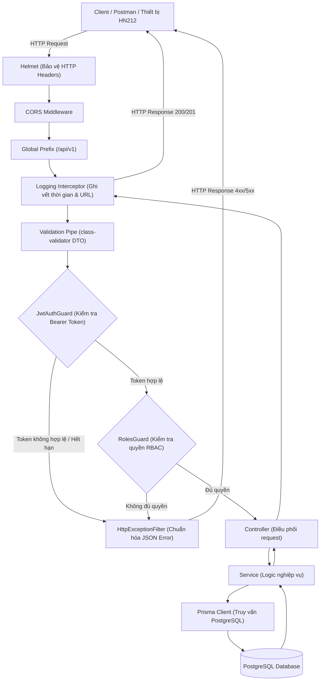
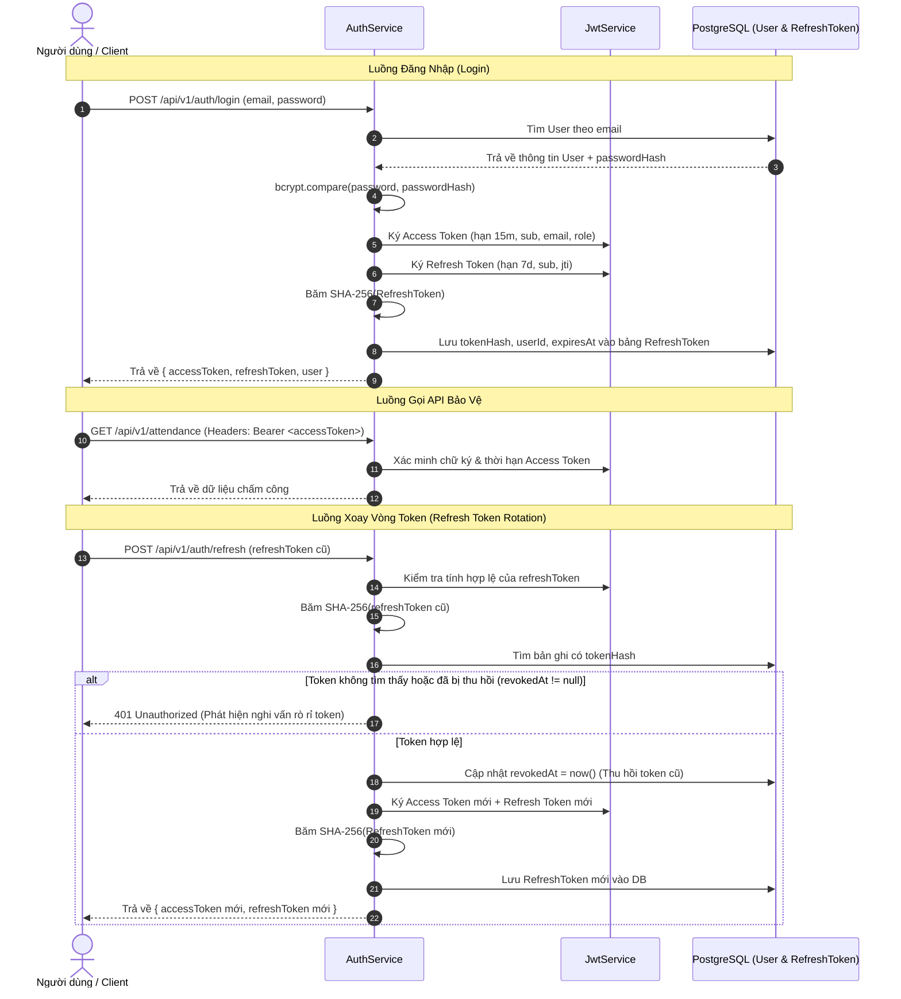

# Kiến Trúc Hệ Thống Vietsage Education API

Tài liệu này mô tả tổng quan kiến trúc hệ thống, các lớp xử lý, nguyên tắc thiết kế và luồng xác thực / phân quyền trong dự án **Vietsage Education API**.

---

## 1. Mục Tiêu Thiết Kế
- **Tính module hóa (Modular Architecture):** Tách biệt các miền nghiệp vụ (`auth`, `users`, `hn212`, `attendance`, `health`) theo chuẩn NestJS.
- **Bảo mật nhiều lớp (Defense in Depth):**
  - Không lưu mật khẩu thuần (sử dụng `bcrypt` với 12 salt rounds).
  - Không lưu `refreshToken` dạng raw trong cơ sở dữ liệu (sử dụng băm SHA-256 để chống lộ phiên ngay cả khi database bị dump).
  - Xoay vòng token (Refresh Token Rotation): Mỗi lần cấp lại Access Token sẽ thu hồi Refresh Token cũ và sinh Refresh Token mới.
  - Phân quyền theo vai trò (Role-Based Access Control - RBAC) với `RolesGuard`.
- **Tích hợp phần cứng / Plugin (HN212 Device Adapter):**
  - Chống trùng lặp sự kiện (Idempotency) dựa trên khóa duy nhất `eventId`.
  - Hỗ trợ lưu payload gốc (`rawPayload` kiểu JSONB) phục vụ đối soát và kiểm toán.
  - Ghi nhận trạng thái kết nối (`lastSeenAt`) của thiết bị tự động.
- **Tập trung hóa xử lý lỗi (Centralized Error Handling):**
  - Exception Filter toàn cục chuẩn hóa cấu trúc lỗi trả về dạng JSON nhất quán.
  - Ẩn toàn bộ stack trace và chi tiết nhạy cảm ở môi trường production.

---

## 2. Bố Cục Thư Mục Dự Án (Project Layout)

```text
vietsage-edu_api/
├── backend-api/                         # Ứng dụng Backend NestJS chính
│   ├── prisma/
│   │   ├── migrations/                  # Lịch sử migration cơ sở dữ liệu
│   │   ├── schema.prisma                # Schema định nghĩa database models & enums
│   │   └── seed.ts                      # Script khởi tạo tài khoản mẫu & thiết bị mẫu
│   ├── src/
│   │   ├── common/                      # Thành phần dùng chung toàn hệ thống
│   │   │   ├── decorators/              # Custom Decorators (@Roles, @CurrentUser,...)
│   │   │   ├── filters/                 # Exception Filters (HttpExceptionFilter)
│   │   │   ├── guards/                  # Guards (JwtAuthGuard, RolesGuard)
│   │   │   ├── interceptors/            # LoggingInterceptor, TransformInterceptor
│   │   │   └── pipes/                   # Validation Pipes
│   │   ├── config/                      # Cấu hình biến môi trường
│   │   ├── modules/                     # Các module nghiệp vụ
│   │   │   ├── auth/                    # Đăng ký, đăng nhập, xoay vòng token, đăng xuất
│   │   │   ├── users/                   # Quản lý tài khoản, thông tin cá nhân, cập nhật trạng thái
│   │   │   ├── hn212/                   # Adapter tiếp nhận sự kiện chấm công từ HN212
│   │   │   ├── attendance/              # Truy vấn, thống kê lịch sử chấm công
│   │   │   └── health/                  # Health check & kiểm tra kết nối DB
│   │   ├── prisma/                      # PrismaService & PrismaModule
│   │   ├── app.module.ts                # Root module của ứng dụng
│   │   └── main.ts                      # Điểm khởi chạy (Bootstrap application)
│   ├── .env                             # File cấu hình biến môi trường thực tế
│   ├── .env.example                     # File mẫu biến môi trường
│   ├── Dockerfile                       # Multi-stage Dockerfile cho production
│   ├── docker-compose.yml               # Cấu hình khởi chạy API & PostgreSQL container
│   ├── package.json                     # Danh sách phụ thuộc và scripts
│   └── vietsage-edu_api.postman_collection.json # Bộ test Postman
├── backend-docs/                        # Toàn bộ tài liệu kỹ thuật & đặc tả hệ thống
│   ├── ARCHITECTURE.md                  # Kiến trúc hệ thống và luồng dữ liệu
│   ├── DATABASE_ERD.md                  # Sơ đồ quan hệ thực thể (ERD) & giải thích
│   ├── API_SPECIFICATION.md             # Đặc tả chi tiết các endpoint API
│   └── HN212_INTEGRATION_GUIDE.md       # Hướng dẫn tích hợp thiết bị/plugin HN212
└── backend-logs/                        # Thư mục chứa các file log của hệ thống
    ├── application-%DATE%.log           # Log hoạt động chung
    ├── error-%DATE%.log                 # Log ngoại lệ và lỗi hệ thống
    └── hn212-%DATE%.log                 # Log sự kiện chấm công nhận từ thiết bị
```

---

## 3. Luồng Xử Lý Request (Request Lifecycle)



---

## 4. Cơ Chế Xác Thực & Xoay Vòng Token (Authentication & Token Rotation)


