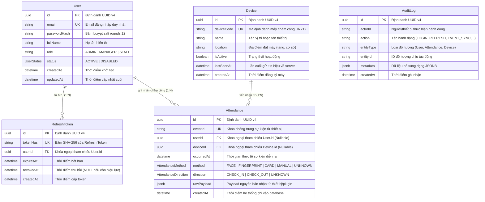

# Sơ Đồ Cơ Sở Dữ Liệu (Database ERD) & Thiết Kế Schema

Hệ thống cơ sở dữ liệu của **Vietsage Education API** được xây dựng trên nền tảng **PostgreSQL 16**, quản trị và ánh xạ thông qua **Prisma ORM**.

---

## 1. Sơ Đồ Quan Hệ Thực Thể (Entity Relationship Diagram - ERD)

---

## 2. Các Kiểu Liệt Kê (Enums)

### 2.1. `UserStatus`
- `ACTIVE`: Tài khoản đang hoạt động bình thường, được phép đăng nhập.
- `DISABLED`: Tài khoản đã bị khóa/vô hiệu hóa bởi Admin, không thể đăng nhập hoặc làm mới token.

### 2.2. `AttendanceMethod` (Hình thức chấm công)
- `FACE`: Nhận diện khuôn mặt (Face Recognition).
- `FINGERPRINT`: Nhận diện vân tay (Fingerprint).
- `CARD`: Thẻ từ / RFID.
- `MANUAL`: Điểm danh thủ công qua API quản trị viên.
- `UNKNOWN`: Chưa xác định (dùng khi thiết bị gửi mã hình thức mới chưa ánh xạ).

### 2.3. `AttendanceDirection` (Chiều vào / ra)
- `CHECK_IN`: Vào ca / bắt đầu ngày làm việc.
- `CHECK_OUT`: Tan ca / kết thúc ngày làm việc.
- `UNKNOWN`: Sự kiện ghi nhận không phân biệt chiều vào/ra.

---

## 3. Chi Tiết Các Bảng & Chỉ Mục (Tables & Indexes)

### Bảng `User`
| Tên cột | Kiểu | Ràng buộc | Mô tả |
|---|---|---|---|
| `id` | UUID | PRIMARY KEY | Khóa chính tự sinh UUID v4 |
| `email` | TEXT | UNIQUE, NOT NULL | Email đăng nhập, có Unique Index |
| `passwordHash` | TEXT | NOT NULL | Mật khẩu đã được mã hóa bằng bcrypt |
| `fullName` | TEXT | NOT NULL | Họ và tên nhân viên/quản trị viên |
| `role` | TEXT | DEFAULT 'STAFF', NOT NULL | Quyền hạn: `ADMIN`, `MANAGER`, `STAFF` |
| `status` | ENUM(`UserStatus`) | DEFAULT 'ACTIVE', NOT NULL | Trạng thái tài khoản |
| `createdAt` | TIMESTAMP | DEFAULT CURRENT_TIMESTAMP | Ngày tạo tài khoản |
| `updatedAt` | TIMESTAMP | AUTO-UPDATED | Ngày cập nhật |

### Bảng `RefreshToken`
| Tên cột | Kiểu | Ràng buộc | Mô tả |
|---|---|---|---|
| `id` | UUID | PRIMARY KEY | Khóa chính |
| `tokenHash` | TEXT | UNIQUE, NOT NULL | Chuỗi băm SHA-256 từ chuỗi refresh token |
| `userId` | UUID | FOREIGN KEY -> `User(id)` | Tham chiếu người dùng sở hữu token. `ON DELETE CASCADE` |
| `expiresAt` | TIMESTAMP | NOT NULL | Thời điểm hết hạn phiên |
| `revokedAt` | TIMESTAMP | NULLABLE | Nếu có giá trị, phiên này đã bị hủy bỏ |
| `createdAt` | TIMESTAMP | DEFAULT CURRENT_TIMESTAMP | Thời điểm cấp phát |

- **Chỉ mục:** `CREATE INDEX "RefreshToken_userId_idx" ON "RefreshToken"("userId");`

### Bảng `Device`
| Tên cột | Kiểu | Ràng buộc | Mô tả |
|---|---|---|---|
| `id` | UUID | PRIMARY KEY | Khóa chính |
| `deviceCode` | TEXT | UNIQUE, NOT NULL | Mã phần cứng thiết bị (ví dụ: `HN212-01`) |
| `name` | TEXT | NOT NULL | Tên thân thiện (ví dụ: `Máy chấm công Cổng 1`) |
| `location` | TEXT | NULLABLE | Vị trí đặt thiết bị |
| `isActive` | BOOLEAN | DEFAULT true, NOT NULL | Bật/tắt tiếp nhận dữ liệu |
| `lastSeenAt` | TIMESTAMP | NULLABLE | Thời điểm gửi tín hiệu/heartbeat gần nhất |
| `createdAt` | TIMESTAMP | DEFAULT CURRENT_TIMESTAMP | Ngày thêm thiết bị vào hệ thống |

### Bảng `Attendance`
| Tên cột | Kiểu | Ràng buộc | Mô tả |
|---|---|---|---|
| `id` | UUID | PRIMARY KEY | Khóa chính |
| `eventId` | TEXT | UNIQUE, NOT NULL | Mã sự kiện từ máy chấm công (chống trùng lặp dữ liệu) |
| `userId` | UUID | FOREIGN KEY -> `User(id)` | Khóa ngoại người được điểm danh (`ON DELETE SET NULL`) |
| `deviceId` | UUID | FOREIGN KEY -> `Device(id)` | Khóa ngoại máy chấm công tiếp nhận (`ON DELETE SET NULL`) |
| `occurredAt` | TIMESTAMP | NOT NULL | Thời điểm quẹt thẻ/nhận diện thực tế |
| `method` | ENUM(`AttendanceMethod`) | DEFAULT 'UNKNOWN', NOT NULL | Phương thức xác thực |
| `direction` | ENUM(`AttendanceDirection`) | DEFAULT 'UNKNOWN', NOT NULL | Chiều vào/ra |
| `rawPayload` | JSONB | NULLABLE | Toàn bộ dữ liệu JSON nhận được từ thiết bị |
| `createdAt` | TIMESTAMP | DEFAULT CURRENT_TIMESTAMP | Thời điểm lưu vào database |

- **Chỉ mục hiệu năng truy vấn:**
  - `CREATE INDEX "Attendance_userId_occurredAt_idx" ON "Attendance"("userId", "occurredAt");`
  - `CREATE INDEX "Attendance_deviceId_occurredAt_idx" ON "Attendance"("deviceId", "occurredAt");`

### Bảng `AuditLog`
| Tên cột | Kiểu | Ràng buộc | Mô tả |
|---|---|---|---|
| `id` | UUID | PRIMARY KEY | Khóa chính |
| `actorId` | TEXT | NULLABLE | ID người dùng hoặc mã thiết bị |
| `action` | TEXT | NOT NULL | Tên thao tác (`USER_CREATE`, `EVENT_RECEIVE`,...) |
| `entityType` | TEXT | NOT NULL | Loại thực thể |
| `entityId` | TEXT | NULLABLE | ID thực thể |
| `metadata` | JSONB | NULLABLE | Dữ liệu kèm theo |
| `createdAt` | TIMESTAMP | DEFAULT CURRENT_TIMESTAMP | Thời điểm phát sinh |

- **Chỉ mục:** `AuditLog_entityType_entityId_idx`, `AuditLog_createdAt_idx`.
