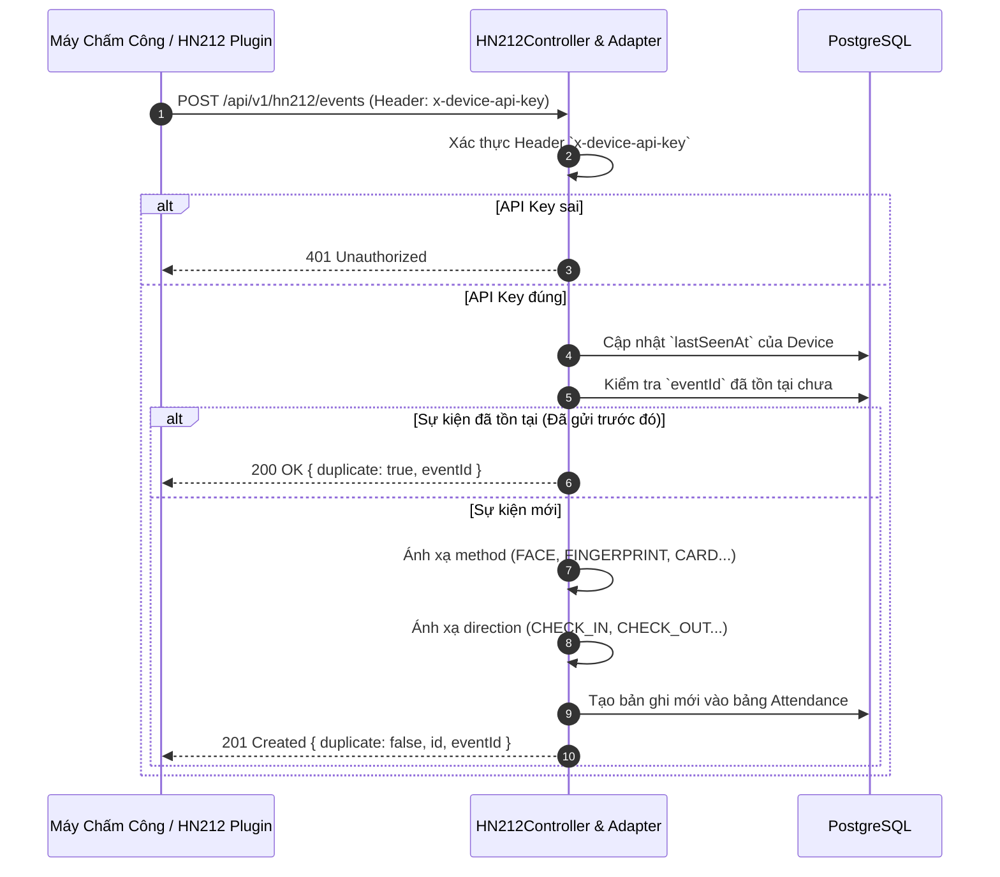

# Hướng Dẫn Tích Hợp Thiết Bị / Plugin HN212

Tài liệu này cung cấp hướng dẫn kỹ thuật chi tiết để tích hợp máy chấm công hoặc phần mềm trung gian (plugin) **HN212** với hệ thống Backend Vietsage Education API.

---

## 1. Tổng Quan Giao Tiếp
Do tài liệu chính thức của nhà sản xuất HN212 có thể thay đổi tùy thuộc vào firmware và phiên bản phần cứng, hệ thống Vietsage API áp dụng mô hình **Adapter Pattern**:
- Tiếp nhận dữ liệu qua giao thức HTTP POST dạng JSON.
- Tự động nhận diện và bóc tách các trường phổ biến (`eventId`, `deviceCode`, `occurredAt`, `method`, `direction`).
- Lưu trữ toàn bộ payload thô trong cột `rawPayload` (PostgreSQL JSONB) để phục vụ đối soát khi cần phân tích chuyên sâu.



---

## 2. Yêu Cầu Xác Thực
Mọi request gửi tới endpoint tiếp nhận sự kiện bắt buộc phải kèm theo Header bảo mật:
```http
x-device-api-key: <Giá_trị_HN212_API_KEY_trong_.env>
```
Nếu thiếu header hoặc giá trị không khớp với biến môi trường của server, API sẽ trả về lỗi `401 Unauthorized` và chặn toàn bộ quá trình xử lý.

---

## 3. Quy Cách Payload Gửi Lên

Endpoint: `POST /api/v1/hn212/events`  
Header: `Content-Type: application/json`

### 3.1. Các Trường Được Nhận Diện Tự Động
Hệ thống tự động tìm kiếm giá trị từ các trường tương đương sau:
- **Mã sự kiện duy nhất (`eventId`):** Tìm theo các khóa `eventId`, `event_id`, `recordId`, `id`.
- **Mã thiết bị (`deviceCode`):** Tìm theo `deviceCode`, `device_code`, `serialNumber`.
- **Thời gian diễn ra (`occurredAt`):** Tìm theo `occurredAt`, `timestamp`, `time`, `datetime`. Định dạng chuẩn là ISO 8601 (ví dụ: `2026-10-18T08:30:00.000Z`).
- **Hình thức xác minh (`method`):**
  - Chứa chữ `face` -> Chuyển thành `FACE`
  - Chứa chữ `finger` hoặc `fp` -> Chuyển thành `FINGERPRINT`
  - Chứa chữ `card` -> Chuyển thành `CARD`
  - Chứa chữ `manual` -> Chuyển thành `MANUAL`
  - Khác -> Chuyển thành `UNKNOWN`
- **Chiều ra vào (`direction`):**
  - Khớp với `in`, `check_in`, `checkin`, `entry` -> Chuyển thành `CHECK_IN`
  - Khớp với `out`, `check_out`, `checkout`, `exit` -> Chuyển thành `CHECK_OUT`
  - Khác -> Chuyển thành `UNKNOWN`

### 3.2. Ví Dụ Payload

#### Trường hợp 1: Nhận diện khuôn mặt (Face Recognition)
```json
{
  "eventId": "EVT_HN212_20261018_091520_123",
  "deviceCode": "HN212-LOC01",
  "occurredAt": "2026-10-18T09:15:20.000Z",
  "method": "face",
  "direction": "in",
  "userCode": "EMP-0012",
  "temperature": 36.5,
  "mask": true
}
```

#### Trường hợp 2: Quẹt vân tay (Fingerprint)
```json
{
  "event_id": "FP_20261018_173000_999",
  "serialNumber": "HN212-LOC02",
  "timestamp": "2026-10-18T17:30:00.000Z",
  "verifyType": "fingerprint",
  "type": "out",
  "userCode": "EMP-0045"
}
```

#### Trường hợp 3: Quẹt thẻ từ (RFID Card)
```json
{
  "recordId": "CARD_REC_5512",
  "device_code": "HN212-LOC01",
  "datetime": "2026-10-18T08:00:15.000Z",
  "method": "card",
  "direction": "in",
  "cardNumber": "0008472910"
}
```

---

## 4. Xử Lý Mất Mạng & Đồng Bộ Ngoại Tuyến (Offline Sync)
Khi đường truyền Internet hoặc mạng nội bộ tại cơ sở bị gián đoạn:
1. Thiết bị/Plugin HN212 phải lưu trữ cục bộ các bản ghi chấm công kèm `eventId` nguyên bản.
2. Khi có mạng trở lại, thiết bị có thể gửi lại toàn bộ danh sách sự kiện lên API.
3. Do hệ thống đã áp dụng ràng buộc `UNIQUE` trên cột `eventId`, những sự kiện đã được lưu trước đó sẽ nhận phản hồi `{ "success": true, "duplicate": true }` mà không bị ghi đè hay nhân đôi giờ làm việc của nhân viên.

---

## 5. Khuyến Cáo Bảo Mật Dữ Liệu Sinh Trắc Học
- **Tuyệt đối không truyền ảnh khuôn mặt hoặc mẫu vân tay nhị phân thô (Raw Biometrics)** qua HTTP trừ khi có kênh VPN mã hóa chuyên biệt và được sự đồng ý pháp lý của người lao động.
- Chỉ gửi mã định danh nhân viên (`userCode` / `userId`) và kết quả xác minh thành công từ phần cứng HN212.
